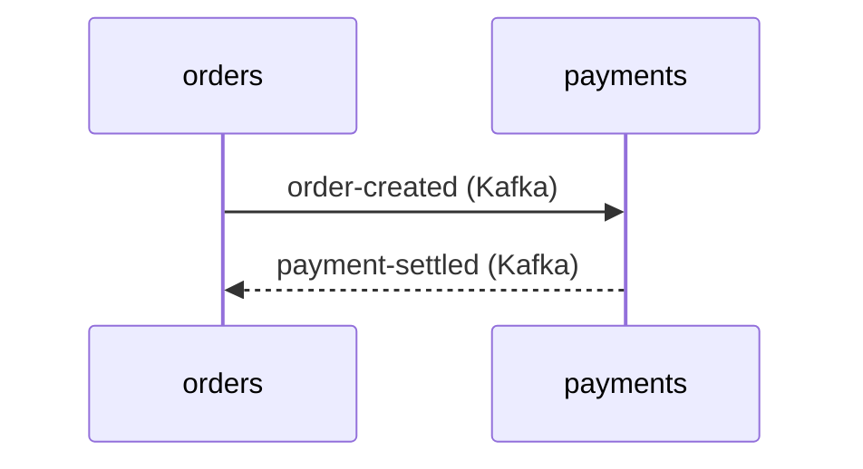

# Platform Graph

The platform vault is a knowledge graph of how the platform works. Each node is a short note. Each link in a note body is a line in Obsidian's graph view. It grows only from production code that Claude reads during real work.

**Vault path:** given at session start as `Platform graph vault: <path>`. If that line is missing, take the `PLATFORM_VAULT=` value from the knowledge-vault hook commands in `~/.claude/settings.json`. If there is none, the platform vault is not installed: do nothing.
**Current service:** the `Current project:` name at session start. It is the repo name from the git remote.

## Nodes and names

| Node | Folder | File name | Example |
|---|---|---|---|
| Service | `services/` | repo name | `services/orders.md` |
| Kafka topic | `kafka/` | the topic name, verbatim | `kafka/order-created.md` |
| API | `apis/` | gRPC: full service name; REST: `<service>-rest` | `apis/shop.orders.Orders.md`, `apis/orders-rest.md` |
| Database | `databases/` | `<owner-service>-db` | `databases/orders-db.md` |
| Flow | `flows/` | kebab-case business name | `flows/checkout.md` |

Links resolve by file name across the whole vault, so names must be unique. If a name still clashes, append the type, for example `checkout-flow`.

**What a service is:** one repo is one service page. A repo with several deployables (for example a host and a worker) gets one page with a section per deployable. Library, chart, environment and tooling repos never get a service page. Their production config (for example a CDC connector or Helm values) is still valid evidence for the services it configures.

## Evidence

Record only what production code or production config shows. These signals count:

- gRPC server registration (a mapped gRPC service) or a gRPC client for another service's proto.
- A Kafka producer or consumer, with its topic name from code or config.
- A REST client with a base address that points at another service.
- A DbContext, migrations, or grain storage, which shows the database a service owns.
- A CDC connector config, which shows a service's database feeding a topic.

**Never** use evidence from paths under `test`, `tests`, `*Tests*`, `spec`, `fixtures` or `samples`, or from build output under `bin` or `obj`. A test that calls an API proves nothing about production. If the only evidence is a test, refuse to record the connection and say why. A wrong edge is worse than a missing edge.

## Record at the end of a task

When the task's work showed a connection, update the graph before the task ends:

1. Search the vault first (see Search). Update existing pages; never create a duplicate.
2. Record only what the evidence shows. Add each file to the page's `sources` as `<repo>:<path>[:<line>]`.
3. Touch at most 6 pages per task. Leave the rest for a later task.
4. If a neighbour service has no page, create a stub with `status: stub`. Its facts come from the side you read.
5. A stub becomes `status: verified` only in a session in that service's own repo. That session rewrites the page from its own code, replaces stub facts that differ, and adds its own `sources`.
6. Create or update a flow page only when a business flow was traced end to end, or when the user asks for it.
7. When code shows a connection is gone, remove the link and add the file that shows it to `sources`.
8. Never write secrets, connection strings, hostnames with credentials, or real data values.

Do not commit or push. The Stop hook syncs the vault at the end of every turn.

## Page format

Properties never contain links. Body sections hold all links, one per line. Leave out empty sections. Both sides of a connection link each other: the service page links the topic it produces, and the topic page links the service back. Keep node pages under about 40 lines and flow pages under about 80.

```markdown
---
type: service | kafka-topic | api | database | flow
summary: One line on what this is
status: verified | stub
updated: YYYY-MM-DD
sources:
  - orders:src/Orders.Host/Kafka/OrderCreatedProducer.cs:42
---
```

**Service** (`services/orders.md`):

```markdown
## What it does
Takes orders and tracks them until they are paid.
## Exposes
- [[shop.orders.Orders]]
## Calls
- [[shop.payments.Payments]] — to charge an order
## Produces
- [[order-created]]
## Consumes
- [[payment-settled]]
## Owns
- [[orders-db]]
## Reads
- [[catalog-db]] — through CDC
## Flows
- [[checkout]]
## Gotchas
```

**Kafka topic** (`kafka/order-created.md`): `## Produced by` · `## Consumed by` · `## Message` (the shape in a few lines) · `## Flows`.

**API** (`apis/shop.orders.Orders.md`): `## Kind` (gRPC or REST) · `## Served by` · `## Methods` (names only) · `## Called by`.

**Database** (`databases/orders-db.md`): `## Owned by` · `## Engine` · `## Main tables or state` · `## Read by`.

**Flow** (`flows/checkout.md`):

````markdown
## Steps
1. [[orders]] takes the order and publishes [[order-created]].
2. [[payments]] consumes it and charges through [[shop.payments.Payments]].
## Diagram

## Services involved
- [[orders]]
- [[payments]]
````

## Search

1. Read the current service's page if the session start did not load it: `<vault>/services/<service>.md`.
2. **With qmd** (`command -v qmd` succeeds):
   - `qmd query "<what you need, in plain words>" -c platform -n 5 --full-path` searches by meaning.
   - `qmd search "<exact topic, API or service name>" -c platform -n 5 --full-path` is a faster keyword search.
3. **Without qmd, or if it fails:** Grep in `<vault>` with glob `{services,kafka,apis,databases,flows}/**/*.md`. For everything linked to a node, search `\[\[<name>\]\]`.
4. Before changing how a service talks to others, read its page and its direct neighbours. Treat the pages as history: confirm against the current code before you rely on them.
